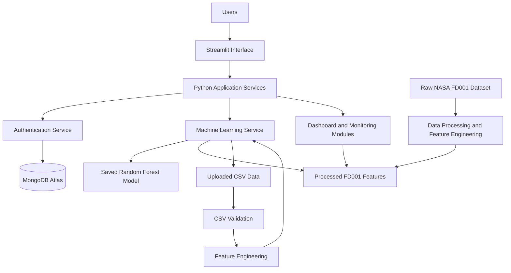

# Predictive Maintenance of Industrial Equipment Using Machine Learning

<p align="center">
  <strong>Machine Learning | Random Forest | Streamlit | MongoDB Atlas</strong>
</p>

An interactive machine learning application that estimates the Remaining Useful Life (RUL) of turbofan engines using the NASA C-MAPSS FD001 dataset. This project combines a trained Random Forest regression model, an interactive Streamlit dashboard, CSV-based instant prediction, historical engine analysis, and simulated engine monitoring.

**Project Type:** Academic Group Project  
**Repository:** [Predictive-Maintenance-ML](https://github.com/Shibani-09/-Predictive-Maintenance-ML)

> **Monitoring scope:** The monitoring module replays historical records from the processed NASA dataset. It does not connect to physical industrial equipment, live sensors, or IoT devices.

---

## 1. Project Overview

Predictive maintenance uses equipment operating conditions and historical data to help identify potential maintenance requirements before equipment failure.

Remaining Useful Life (RUL) estimates the number of operating cycles an engine may have remaining before reaching the end of its useful life. Such estimates can help prioritize inspections and support maintenance planning.

This project applies supervised machine learning to historical engine operating settings and sensor-derived features from the NASA C-MAPSS FD001 dataset.

A trained Random Forest regression model estimates engine RUL in operating cycles. The Streamlit application presents these predictions through an interactive dashboard with engine-level analysis, CSV-based prediction, model evaluation results, and simulated monitoring.

The application also allows users to upload new engine sensor data in CSV format and generate predictions using the existing trained model without retraining it.

## 2. Problem Statement

Traditional maintenance approaches often depend on fixed maintenance schedules or respond only after equipment failure. These approaches may result in unnecessary maintenance, unexpected downtime, and inefficient resource planning.

This project explores how machine learning can use historical engine degradation patterns to estimate Remaining Useful Life and provide an accessible interface for examining engine health.

It also introduces an upload-based prediction workflow that allows users to submit new sensor records and obtain RUL estimates without manually modifying the existing dataset.

## 3. Project Objectives

- Prepare engine-cycle records and RUL targets using the NASA C-MAPSS FD001 dataset.
- Use a trained Random Forest regression model to estimate Remaining Useful Life.
- Develop an interactive Streamlit application for engine-level predictions.
- Allow users to upload new raw sensor CSV files and generate instant RUL predictions.
- Validate uploaded data before processing and prediction.
- Present saved machine learning evaluation results and visualizations.
- Implement simulated engine monitoring using historical test records.
- Integrate MongoDB Atlas for application user account storage.

## 4. Key Features

| Feature | Description |
|---|---|
| User Authentication | Optional registration and login with bcrypt hashing; disabled by default and configurable with `AUTH_ENABLED`. |
| Home Dashboard | Displays actual model predictions, equipment health distribution, saved evaluation metrics, and MongoDB status. |
| Engine Prediction | Predicts every row in an existing processed CSV selected from `data/`. |
| CSV Upload and Instant Prediction | Validates new raw engine sensor data and generates predictions for every uploaded record with the existing trained model. |
| CSV Data Validation | Checks uploaded file structure, required columns, missing values, and invalid data. |
| Dataset Preview | Displays uploaded CSV records before prediction. |
| Batch Engine Prediction | Generates predictions for multiple engines contained in an uploaded CSV file. |
| Prediction Download | Allows users to download prediction results as a CSV file. |
| Prediction History | Stores per-user prediction metadata; small reports are retained only when under 256 KiB. |
| Sensor Trend Analysis | Displays historical sensor trends for a selected engine and sensor channel. |
| Simulated Monitoring | Replays engine records cycle by cycle and generates predictions for selected records. |
| Model Performance | Presents saved evaluation metrics, dataset summaries, and model visualizations. |
| Health Classification | Assigns engine health categories based on predicted RUL. |
| Maintenance Recommendations | Provides recommendations based on the predicted RUL category. |

### Engine Health Classification

The application uses the following RUL thresholds:

| Health Category | Predicted RUL |
|---|---:|
| Critical | 30 cycles or less |
| Warning | Above 30 and up to 60 cycles |
| Monitor | Above 60 and up to 120 cycles |
| Healthy | Above 120 cycles |

These categories are application-defined indicators and should be treated as decision-support information rather than guaranteed failure predictions.

## 5. Technology Stack

| Area | Technologies |
|---|---|
| Programming Language | Python |
| Application Interface | Streamlit |
| Machine Learning | Scikit-learn, Random Forest |
| Data Processing | Pandas, NumPy |
| Data Visualization | Matplotlib |
| Model Storage and Loading | Joblib |
| Database | MongoDB Atlas |
| Database Connectivity | PyMongo |
| Authentication | bcrypt |
| Configuration | python-dotenv |
| Model Comparison | XGBoost |

**Note:** PyMySQL is included in the requirements for a separate legacy migration utility. MongoDB Atlas is the active database used by the Streamlit application.

## 6. System Architecture

The final application follows a direct Python-based architecture. Streamlit communicates with reusable Python services and modules, which access the saved machine learning model and processed dataset.

MongoDB Atlas is used for application accounts and optional per-user prediction history.



The Streamlit application directly uses Python modules. A separate REST API backend is not part of the final application architecture.

## 7. Application Workflow

### Existing Dataset Prediction Workflow

1. **Dataset Preparation:** Raw NASA FD001 training, testing, and RUL files are processed to generate the required features.
2. **Model Development:** A trained Random Forest model and its feature-column configuration are saved as model artifacts.
3. **User Authentication:** Users register or log in through the Streamlit application. Account information is accessed through MongoDB Atlas.
4. **Dataset Selection:** A user selects a processed CSV discovered under `data/`.
5. **RUL Prediction:** The prediction service validates model features, arranges them in the saved model-column order, and predicts every input row.
6. **Health Classification:** The predicted RUL is mapped to an application-defined health category.
7. **Monitoring Simulation:** Users can replay historical engine records and view predictions for selected cycles.

### New CSV Upload Prediction Workflow

1. **CSV Upload:** The user uploads a new raw engine sensor CSV file through the Engine Prediction page.
2. **Data Preview:** The application displays the uploaded dataset for inspection.
3. **Data Validation:** The system checks the expected C-MAPSS columns, data types, missing values, and valid engine-cycle records.
4. **Feature Engineering:** The uploaded raw sensor data is processed using the existing feature engineering functions.
5. **Feature Alignment:** The generated features are arranged according to the saved model feature-column configuration.
6. **Instant Prediction:** The existing trained Random Forest model generates predictions for every validated input record.
7. **Health Classification:** Each predicted RUL value is mapped to a health category.
8. **Result Display:** The application displays the latest record per engine as a summary and retains the complete per-record prediction table.
9. **CSV Download:** Users can download all original CSV records with prediction, status, risk, source, and UTC timestamp columns.

The uploaded CSV workflow uses the existing trained model. It does not retrain the model during file upload or prediction.

## 8. Dataset Description

This project uses the **NASA C-MAPSS FD001 Turbofan Engine Degradation Dataset**.

The dataset contains simulated turbofan engine operational settings and sensor measurements across multiple operating cycles.

### Dataset Files

| File | Description |
|---|---|
| `train_FD001.txt` | Training engine-cycle records. |
| `test_FD001.txt` | Test engine-cycle records that end before the engines reach their final failure cycles. |
| `RUL_FD001.txt` | Remaining Useful Life values associated with the final observed test record of each engine. |

The raw dataset contains:

- Engine identifiers
- Operating cycle information
- Three operational settings
- Twenty-one sensor measurements

Processed training and testing feature files are available in `data/processed/`.

### Data Preprocessing and Feature Engineering

The existing preparation pipeline performs the following operations:

- Reads the raw whitespace-delimited FD001 files and assigns the appropriate column names.
- Calculates row-level Remaining Useful Life targets.
- Uses the final training cycle of each engine to calculate training RUL.
- Incorporates the supplied final-cycle RUL values when calculating test RUL.
- Removes sensor channels that remain constant in the training data.
- Sorts records by engine ID and operating cycle.
- Calculates five-cycle rolling means and standard deviations for sensor measurements.
- Generates per-sensor changes from the preceding operating cycle.
- Fills missing rolling-standard-deviation and first-cycle change values with zero.
- Saves the processed datasets as CSV files.

The processed files are:

- `data/processed/train_features.csv`
- `data/processed/test_features.csv`

The Streamlit application uses these prepared files rather than repeating feature engineering during each dashboard request.

## 9. CSV Upload and Instant RUL Prediction

The application includes an additional CSV upload feature that allows users to provide new raw engine sensor data and obtain RUL predictions.

This feature is available through the **Engine Prediction** page.

### Supported CSV Format

The upload feature accepts headered raw C-MAPSS-format CSV files.

The expected 26 columns are:

- `engine_id`
- `cycle`
- `setting_1`
- `setting_2`
- `setting_3`
- `sensor_1` through `sensor_21`

Each engine must have at least five observations, with its latest five cycles consecutive, to support the implemented rolling-feature validation.

The uploaded file must contain the expected columns and valid sensor data. Missing, unexpected, non-numeric, or invalid values are rejected with validation feedback.

### CSV Processing

After upload, the application:

1. Reads the CSV file using Pandas.
2. Validates the expected column structure and sensor values.
3. Checks engine identifiers and cycle information.
4. Reuses the existing rolling-feature and change-feature calculations.
5. Generates the required 64 model input features.
6. Aligns the features with the saved `feature_columns.pkl` configuration.
7. Generates predictions for every uploaded record using the exact saved feature order.
8. Adds the prediction, health, risk, source, and UTC timestamp to a complete row-preserving report.

### Prediction Results

The application displays the prediction results in a Streamlit table.

The results include:

- Engine ID
- Predicted Remaining Useful Life
- Engine health classification

Users can also download the generated prediction results as a CSV file.

### Functions Used

| Function | File | Purpose |
|---|---|---|
| `load_uploaded_sensor_csv()` | `streamlit_app/services/ml_service.py` | Reads the uploaded CSV file. |
| `validate_uploaded_sensor_data()` | `streamlit_app/services/ml_service.py` | Validates the uploaded sensor dataset. |
| `add_rolling_features()` | `src/feature_engineering.py` | Calculates rolling sensor statistics. |
| `add_change_features()` | `src/feature_engineering.py` | Calculates sensor changes between cycles. |
| `load_feature_columns()` | `streamlit_app/services/ml_service.py` | Loads the saved model feature-column configuration. |
| `predict_uploaded_engines()` | `streamlit_app/services/ml_service.py` | Processes uploaded engine data and generates predictions. |
| `predict_rul()` | `streamlit_app/services/ml_service.py` | Uses the existing trained model to predict RUL. |
| `classify_engine_health()` | `streamlit_app/pages/engine_prediction.py` | Classifies engine health based on predicted RUL. |

**Important:** This feature performs prediction using newly uploaded historical sensor records. It does not establish a live sensor or IoT connection, and it does not retrain the Random Forest model.

## 10. Machine Learning Model

The application uses a previously trained **Random Forest Regressor** to estimate Remaining Useful Life.

### Saved Model Artifacts

| File | Purpose |
|---|---|
| `models/random_forest_rul_model.pkl` | Trained Random Forest regression model. |
| `models/feature_columns.pkl` | Saved list and ordering of model input features. |

Both artifacts are loaded using Joblib and cached within the Streamlit application.

### Prediction Process

1. The user selects a test engine or uploads new sensor data.
2. The application retrieves the relevant processed or uploaded engine records.
3. Processed data and uploaded raw records use their corresponding validation and feature-engineering paths.
4. The model generates an estimate for every record; the UI summarizes the latest cycle per engine without dropping rows from the report.
5. Input features are arranged according to the saved feature-column configuration.
6. The trained Random Forest model generates an RUL estimate.
7. The application clamps negative predictions to zero and displays the result in operating cycles.

The application uses the saved model for prediction. It does not retrain the model when launched or when a user uploads a CSV file.

## 11. Model Evaluation and Performance

The project includes saved evaluation results comparing Random Forest and XGBoost regression models.

The training script uses an engine-based 80/20 training and validation split with random seed 42.

### Saved Validation Results

| Model | MAE (Cycles) | RMSE (Cycles) | R² Score |
|---|---:|---:|---:|
| Random Forest | 28.117 | 39.742 | 0.694 |
| XGBoost | 28.483 | 39.630 | 0.696 |

**Evaluation notes:**

- MAE represents the average absolute prediction error.
- RMSE gives greater weight to larger prediction errors.
- R² represents the proportion of variance explained by the regression model.
- These values are saved validation results, not guaranteed production performance.

The Streamlit application uses the saved Random Forest model.

### Evaluation Files

- `outputs/model_results.csv`
- `outputs/final_model_metrics.csv`
- `outputs/validation_predictions.csv`

### Available Visualizations

The `outputs/charts/` directory includes:

- Actual versus predicted RUL
- Feature importance
- Model comparison by MAE
- Model comparison by R²
- Prediction error distribution
- Engine RUL prediction visualization

## 12. Application Modules and Dashboard Pages

| Module | Functionality |
|---|---|
| Home Dashboard | Runs the saved model against the processed test dataset and displays actual record, equipment, RUL, health, and saved metric analytics. |
| Engine Prediction | Selects a processed CSV from `data/` or uploads a new raw sensor CSV; predicts every record and provides sensor trends and downloadable reports. |
| CSV Upload Prediction | Accepts C-MAPSS raw sensor CSV files, validates them, generates one prediction per input record, and provides a downloadable report. |
| Prediction History | Shows prediction metadata only for the signed-in user and offers saved reports only when they fit the configured storage limit. |
| Model Performance | Displays processed dataset summaries, saved evaluation results, and visualizations. |
| Simulated Engine Monitoring | Replays selected engine test records and generates predictions for selected cycles. |
| Authentication Service | Handles registration, login, bcrypt password hashing, and account lockout after three failed login attempts. |
| Database Service | Reads local environment variables or Streamlit secrets, pools MongoDB connections, and isolates history by user ID. |
| ML Service | Loads model artifacts, discovers existing data CSVs, validates both processed and uploaded data, and generates row-preserving RUL estimates. |

### Additional Power BI Report

The repository also includes a Power BI dashboard:

`powerbi/Predictive_Maintenance_Dashboard.pbix`

It uses the prepared reporting dataset:

`powerbi/predictive_maintenance_dashboard.csv`

These are additional reporting artifacts and are separate from the Streamlit application's runtime workflow.

## 13. MongoDB Atlas Integration

MongoDB Atlas is used as the application's database for user account management.

The database service:

- Connects to MongoDB Atlas using PyMongo.
- Reads connection configuration from local environment variables or Streamlit secrets.
- Uses the configured database name.
- Verifies database connectivity using a ping.
- Provides access to the `users` collection.
- Saves prediction metadata in a `prediction_history` collection, filtered by signed-in MongoDB user ID.
- Stores a downloadable report only when its UTF-8 CSV is no larger than 256 KiB. Larger reports remain downloadable immediately but are not copied into MongoDB.

The authentication service uses the database for account registration and login. Passwords are stored as bcrypt hashes rather than plaintext passwords.

Authentication is disabled by default (`AUTH_ENABLED=false`). Set it to `true` in the local `.env` only for local login testing. Keep it false in Streamlit Cloud until the instructor confirms that login may be deployed. Existing user records and indexes are reused; the app does not create, drop, or alter user indexes.

A separate migration utility is available at:

`scripts/migrate_mysql_to_mongodb.py`

This is a legacy account-migration utility and is not part of the active Streamlit application workflow.

## 14. Project Directory Structure

```text
Predictive-Maintenance-ML/
│
├── data/
│   ├── raw/
│   │   ├── RUL_FD001.txt
│   │   ├── test_FD001.txt
│   │   └── train_FD001.txt
│   │
│   └── processed/
│       ├── test_features.csv
│       └── train_features.csv
│
├── models/
│   ├── feature_columns.pkl
│   └── random_forest_rul_model.pkl
│
├── outputs/
│   ├── charts/
│   ├── predictions/
│   ├── feature_importance.csv
│   ├── final_model_metrics.csv
│   ├── model_results.csv
│   └── validation_predictions.csv
│
├── powerbi/
│   ├── Predictive_Maintenance_Dashboard.pbix
│   └── predictive_maintenance_dashboard.csv
│
├── scripts/
│   ├── migrate_mysql_to_mongodb.py
│   └── users_indexes_backup.json
│
├── src/
│   ├── config.py
│   ├── create_dashboard_data.py
│   ├── data_loader.py
│   ├── data_quality.py
│   ├── feature_engineering.py
│   ├── model_evaluation.py
│   ├── model_training.py
│   ├── prediction_analysis.py
│   ├── realtime_simulation.py
│   └── test_prediction.py
│
├── streamlit_app/
│   ├── pages/
│   │   ├── __init__.py
│   │   ├── engine_prediction.py
│   │   ├── model_performance.py
│   │   └── realtime_monitoring.py
│   │
│   ├── services/
│   │   ├── __init__.py
│   │   ├── authentication.py
│   │   ├── database.py
│   │   └── ml_service.py
│   │
│   ├── __init__.py
│   └── app.py
│
├── .streamlit/
│   ├── config.toml
│   └── secrets.toml.example
├── tests/
├── .env.example
├── .gitattributes
├── .gitignore
├── requirements.txt
├── requirements-dev.txt
└── pytest.ini
```

## 15. Installation and Setup

Follow these instructions to run the project on a Windows system.

### Prerequisites

- Python installed on your system.
- Git installed.
- Git LFS installed.
- A MongoDB Atlas account and database.

### Step 1: Clone the Repository

Initialize Git LFS and clone the repository:

```powershell
git lfs install

git clone https://github.com/Shibani-09/-Predictive-Maintenance-ML.git Predictive-Maintenance-ML

cd Predictive-Maintenance-ML

git lfs pull
```

Git LFS is required to download the large `.pkl` model artifacts.

### Step 2: Create a Virtual Environment

```powershell
python -m venv .venv
```

### Step 3: Activate the Virtual Environment

```powershell
.\.venv\Scripts\Activate.ps1
```

### Step 4: Install Dependencies

```powershell
python -m pip install -r requirements.txt
python -m pip check
```

### Step 5: Configure MongoDB Atlas

Copy `.env.example` to `.env` in the project root and fill in the existing Atlas connection information locally:

Add your own MongoDB Atlas configuration:

```env
AUTH_ENABLED=true
MONGODB_URI=your_existing_mongodb_connection_string
MONGODB_DATABASE=your_existing_database_name
```

Set `AUTH_ENABLED=true` only for local login testing. Set it back to `false` for public use.

**Security reminder:** Never upload your `.env` file, database credentials, passwords, or connection strings to GitHub.

## 16. Running the Application

From the project root, run:

```powershell
python -m streamlit run streamlit_app/app.py
```

The application will open in your default browser.

The default local address is:

```text
http://localhost:8501
```

The application loads the existing trained model, feature configuration, and processed dataset. Model training is not performed when the application starts.

### Local test commands

```powershell
python -m pip install -r requirements-dev.txt
python -m pip check
python -m pytest -q
python -m streamlit run streamlit_app/app.py
```

In the Engine Prediction page, check the existing processed dataset mode and upload a raw C-MAPSS CSV with the 26 required columns. Reports preserve each input row and can be opened in Excel. The realtime page replays saved dataset records; it is not a sensor feed.

## 17. Streamlit Community Cloud Deployment

Do not deploy login-enabled code or set `AUTH_ENABLED=true` in cloud secrets until the instructor confirms the restriction has changed. No deployment or Git push is performed automatically.

1. Push only reviewed and approved changes to the GitHub `main` branch. The model and feature files are Git LFS tracked; verify the deployed checkout contains the real artifacts rather than short LFS pointer text.
2. Open Streamlit Community Cloud and select **Create app**.
3. Choose repository `Shibani-09/-Predictive-Maintenance-ML`, branch `main`, and main file path `streamlit_app/app.py`.
4. Choose Python **3.13** in the deployment's advanced settings to match the project's tested Python major/minor version.
5. In **Advanced settings → Secrets**, add the existing MongoDB URI and database name using TOML keys. Keep `AUTH_ENABLED = false` until deployment of authentication is authorized:

   ```toml
   AUTH_ENABLED = false
   MONGODB_URI = "your existing Atlas connection string"
   MONGODB_DATABASE = "your existing database name"
   ```

   Never paste secrets into source files, commits, issues, or chat messages. The committed `.streamlit/secrets.toml.example` contains placeholders only.
6. In Atlas Network Access, allow only the current, trusted Streamlit egress addresses or a controlled network path. Do not expose the database to all IP addresses as a convenience.
7. Deploy, inspect the app's build and runtime logs, then test the dashboard, both CSV modes, health summary, and download button. Test login and history only after authorization and with a non-production test account.
8. For future updates, review, stage, commit, and push approved source changes to `main`; Community Cloud rebuilds from that branch. Inspect logs after each rebuild.

### Windows Application Control note

The project's Python 3.13.14 64-bit environment and pinned packages pass `pip check`. The official PyArrow CPython 3.13 Windows wheel is available, and the downloaded PyArrow 26.0.1 wheel matches the SHA-256 published by PyPI. Code Integrity events 3077/3033 block `C:\Projects\Predictive-Maintenance-ML\.venv\Lib\site-packages\pyarrow\_compute.cp313-win_amd64.pyd` under Enterprise policy `0283ac0f-fff1-49ae-ada1-8a933130cad6`; AppLocker has no matching event. The extension SHA-256 is `36C0459EDE8924B4FB30D545A160A3F0E839FCA1253902F4A34C6F604B4F8325`; the official wheel SHA-256 is `8196f36a2f4cb8d2d6ef3651941b80e5ccf125d7653657d99af5bb298e7a7026`.

The same Enterprise policy also blocks the training dependency `C:\Projects\Predictive-Maintenance-ML\.venv\Lib\site-packages\xgboost\lib\xgboost.dll` (events 3077/3033, SHA-256 `29CDFB42C4365E1C731F1F5916210AB8642C1A117FD74D183DDAB2D5F4C214BC`). The Microsoft Visual C++ 14.x runtime (14.50.35719.00) and `vcomp140.dll` are present, so the recorded failures point to code-integrity policy, not missing runtimes or 32-bit Python. Both native files are not individually Authenticode-signed. Do not disable or bypass the policy. Ask the authorized IT/security administrator to review the events and approve the trusted package files through the organization's normal signing/allow-list process. Until approved, Pandas imports, full ML tests, XGBoost imports, and Streamlit page execution cannot be verified on this Windows machine.

## 18. Limitations

- The monitoring module replays historical FD001 test records rather than receiving live industrial sensor data.
- CSV upload supports the specified raw C-MAPSS-format sensor data, not arbitrary CSV formats.
- Each uploaded engine must satisfy the implemented minimum history and consecutive-cycle validation requirements.
- The project currently focuses on the NASA C-MAPSS FD001 dataset.
- Model performance may differ when applied to other equipment, operating conditions, or datasets.
- The reported evaluation metrics are saved validation results and do not guarantee real-world performance.
- The application requires the saved model artifacts and processed feature files to be available.
- MongoDB Atlas connectivity is required for database-dependent authentication functionality.
- RUL estimates and health classifications are decision-support indicators and should not replace qualified maintenance decisions.

## 19. Future Scope

Potential improvements for future development include:

- Integration with validated live industrial sensor data.
- Testing with additional NASA C-MAPSS dataset subsets.
- Further investigation of anomaly detection techniques.
- Monitoring model performance and detecting data drift.
- Additional machine learning model comparisons.
- Maintenance scheduling and notification functionality.
- Improved monitoring and reporting capabilities.

These are proposed future improvements and are not represented as currently implemented features.

## 20. Project Contributors

This project was developed collaboratively as an academic group project. The work involved project planning, dataset preparation, machine learning development, application implementation, database integration, testing, and documentation.

## 21. Acknowledgements

- **NASA Prognostics Center of Excellence:** For providing the C-MAPSS turbofan engine degradation dataset.
- **Python Open-Source Community:** For the libraries and tools used in data processing, machine learning, visualization, and application development.
- **Streamlit:** For providing the framework used to develop the interactive dashboard.

**Dataset Reference:** [NASA Prognostics Data Repository](https://ti.arc.nasa.gov/tech/dash/groups/pcoe/prognostic-data-repository/)

---

<p align="center">
  <strong>Predictive Maintenance of Industrial Equipment Using Machine Learning</strong><br>
  Academic Group Project
</p>
